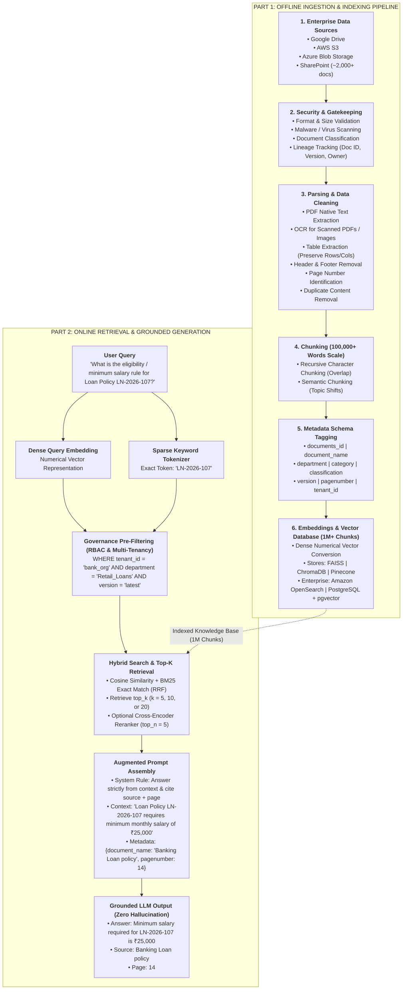

# Enterprise Production RAG Architecture — Forward Deployed Engineer (FDE) Study Notes

> **Session Summary:** End-to-end production Retrieval-Augmented Generation (RAG) architecture covering enterprise data ingestion, parsing, cleaning, chunking, metadata governance, 1M+ vector scaling, hybrid retrieval, and citation-backed generation—demonstrated through a **Banking Loan Policy (`LN-2026-107`)** eligibility use case where the minimum salary requirement is **₹25,000**.

---

## 1. End-to-End Architecture Diagram

### A. Visual Blueprint (Mermaid Flowchart)



### B. ASCII System Architecture View

```text
====================================================================================================
                             PART 1: OFFLINE INGESTION & INDEXING PIPELINE
====================================================================================================

[1. DATA SOURCES]         [2. SECURITY & GATEKEEPING]      [3. PARSING & CLEANING]
  • Google Drive            • Format & Size Validation       • PDF Text Extraction (Digital)
  • AWS S3             ───► • Malware / Virus Scan      ───► • OCR (Scanned Docs / Images)
  • Azure Blob              • Document Classification        • Table Extraction (Structure)
  • SharePoint (~2000)      • Governance & Lineage           • Header / Footer Removal
                              (Doc ID, Version, Owner)       • Page Number Identification
                                                             • Duplicate Content Removal
                                                                          │
                                                                          ▼
[6. VECTOR DATABASE]      [5. EMBEDDINGS & METADATA]       [4. CHUNKING (100,000 Words)]
  • FAISS (Local/PoC)       • Dense Vector Conversion        • Recursive Character Chunking
  • ChromaDB (Dev/Med) ◄─── • Attach Metadata JSON:     ◄───   (Hierarchical + Overlap)
  • Pinecone (Managed)        - documents_id, version        • Semantic Chunking
  • Amazon OpenSearch         - document_name, pagenumber      (Topic/Similarity Shifts)
  • PostgreSQL+pgvector       - tenant_id, department
  (Scale: 1M+ Chunks)         - category, classification

====================================================================================================
                           PART 2: ONLINE RETRIEVAL & GROUNDED GENERATION
====================================================================================================

[USER QUERY]
"What is the eligibility criteria / minimum salary requirement for loan policy LN-2026-107?"
      │
      ├──────────────────────────────────────────┐
      ▼                                          ▼
[DENSE QUERY EMBEDDING]                    [SPARSE KEYWORD TOKENIZER]
  • Convert query to numerical vector        • Extract exact alphanumeric ID: "LN-2026-107"
      │                                          │
      └────────────────────┬─────────────────────┘
                           ▼
[GOVERNANCE PRE-FILTERING (RBAC & MULTI-TENANCY)]
  • Enforce WHERE tenant_id = 'bank_org' AND department = 'Retail_Loans' AND version = 'latest'
                           │
                           ▼
[HYBRID SEARCH (SEMANTIC + BM25) & TOP-K RETRIEVAL]
  • Combine Cosine Similarity + BM25 Exact Match via Reciprocal Rank Fusion (RRF)
  • Retrieve top_k candidates (k = 5, 10, or 20) ──► Optional Cross-Encoder Reranker (top_n = 5)
                           │
                           ▼
[AUGMENTED PROMPT ASSEMBLY]
  • System Rule: "Answer strictly from context. Cite document_name and pagenumber."
  • Context Chunk: "...Loan Policy LN-2026-107 requires a minimum monthly salary of ₹25,000..."
  • Metadata Attached: { document_name: "Banking Loan policy", pagenumber: 14 }
                           │
                           ▼
[GROUNDED LLM GENERATION (ZERO HALLUCINATION)]
  ┌────────────────────────────────────────────────────────────────────────────────────────────┐
  │ Answer: Minimum monthly salary required for Loan Policy LN-2026-107 is ₹25,000.            │
  │ Source: Banking Loan policy                                                                │
  │ Page: 14                                                                                   │
  └────────────────────────────────────────────────────────────────────────────────────────────┘
```

---

## 2. Stage-by-Stage Technical Breakdown

### Stage 1: Enterprise Ingestion & Security Gatekeeping
Before raw files from cloud repositories (**Google Drive, AWS S3, Azure Blob Storage, SharePoint**) reach an AI pipeline, a Forward Deployed Engineer enforces strict ingestion controls:
* **Format & Size Validation:** Reject unsupported file extensions, corrupted binaries, or oversized files before spending compute.
* **Malware Scanning:** Scan every incoming file to protect internal enterprise storage and workers.
* **Document Classification:** Route files by type (e.g., *Banking Policies, Contracts, SOPs, Invoices*) to specialized parsing pipelines.
* **Governance & Lineage:** Record **Document IDs, versions, and ownership** so updated policies overwrite stale versions and compliance audit trails remain intact.

---

### Stage 2: Parsing & Data Cleaning
Raw enterprise PDFs contain structural noise that corrupts embeddings and causes LLM hallucinations:
* **PDF Text Extraction:** Extract native digital text from standard PDFs (e.g., via PyMuPDF, `pdfplumber`).
* **OCR (Optical Character Recognition):** Convert scanned documents, faxes, and embedded images into machine-readable text (e.g., via AWS Textract, Azure Document Intelligence, Tesseract).
* **Table Extraction:** Preserve row-to-column relationships (converting tables into Markdown or JSON) so eligibility matrices and salary slabs stay intact.
* **Header, Footer & Duplicate Removal:** Strip repetitive page headers/footers and deduplicate boilerplate clauses to avoid polluting search results.
* **Page Number Tracking:** Retain exact page numbers per text block for verifiable citations.

---

### Stage 3: Chunking Strategy (100,000+ Words Scale)
Large enterprise policies cannot fit into a single embedding call or LLM prompt without losing precision:
* **Recursive Character Chunking:** Splits text hierarchically (`\n\n` → `\n` → `.` → ` `) with a fixed token/character overlap (e.g., 500–800 tokens with 10–15% overlap) so rules split across boundaries are not lost.
* **Semantic Chunking:** Uses embedding similarity between adjacent sentences to split chunks only when the topic shifts, keeping complete policy clauses intact.

---

### Stage 4: Metadata Schema Tagging & Governance
Every chunk is stored alongside structured metadata JSON to enforce security and auditability:

```json
{
  "documents_id": "DOC-9941",
  "document_name": "Banking Loan policy",
  "department": "Retail_Loans",
  "category": "Credit_Eligibility",
  "classification": "Internal_Confidential",
  "version": "2026.1",
  "pagenumber": 14,
  "tenant_id": "bank_org"
}
```

---

### Stage 5: Embeddings & Vector Database Scaling (1M+ Chunks)
* **Dense Embeddings:** Pass each clean chunk through an embedding model (e.g., `text-embedding-3-large`, `BGE-M3`, `Cohere Embed`) to generate dense numerical vectors.
* **Vector Store Selection by Scale:**
  * **Local / PoC:** FAISS, ChromaDB
  * **Managed Cloud:** Pinecone, Qdrant, Weaviate
  * **Enterprise Integrated:** Amazon OpenSearch, PostgreSQL + `pgvector`

---

### Stage 6: Hybrid Retrieval, Reranking & Citation-Backed Generation
1. **Metadata Pre-Filtering (RBAC & Multi-Tenancy):** Filter vectors *before* similarity search (`tenant_id = 'bank_org'`, `department = 'Retail_Loans'`, `version = 'latest'`) to prevent cross-tenant data leaks and outdated policy answers.
2. **Hybrid Search (Dense + Sparse):**
   * **Dense Vector Search (Cosine Similarity):** Captures semantic meaning (*"eligibility criteria"* ≈ *"minimum salary requirement"*).
   * **Sparse Keyword Search (BM25):** Captures exact alphanumeric identifiers (`LN-2026-107`) that dense embeddings often blur.
   * **Reciprocal Rank Fusion (RRF):** Merges dense and sparse rankings into a single candidate list (`top_k = 10` or `20`).
3. **Cross-Encoder Reranking (Optional):** Scores query-chunk pairs jointly to select the `top_n = 5` most relevant chunks.
4. **Grounded Prompt & Citations:** Instruct the LLM to answer *only* from the retrieved context and attach `document_name` and `pagenumber` (`Banking Loan policy`, Page `14` → **₹25,000** minimum salary).
