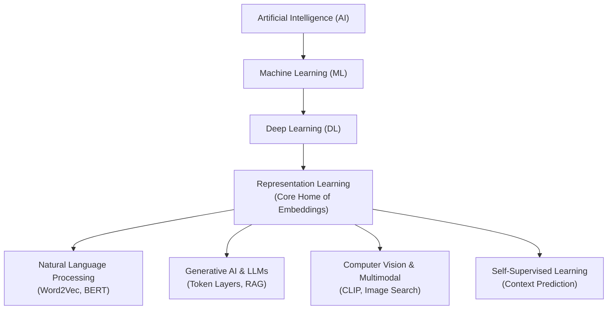
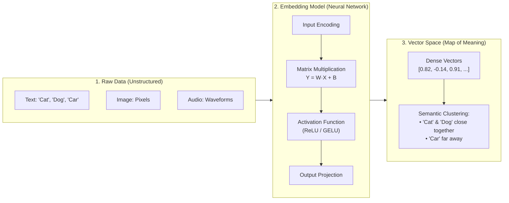
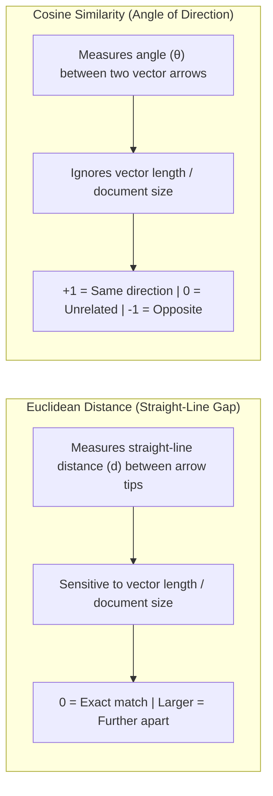
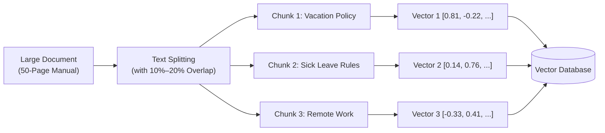
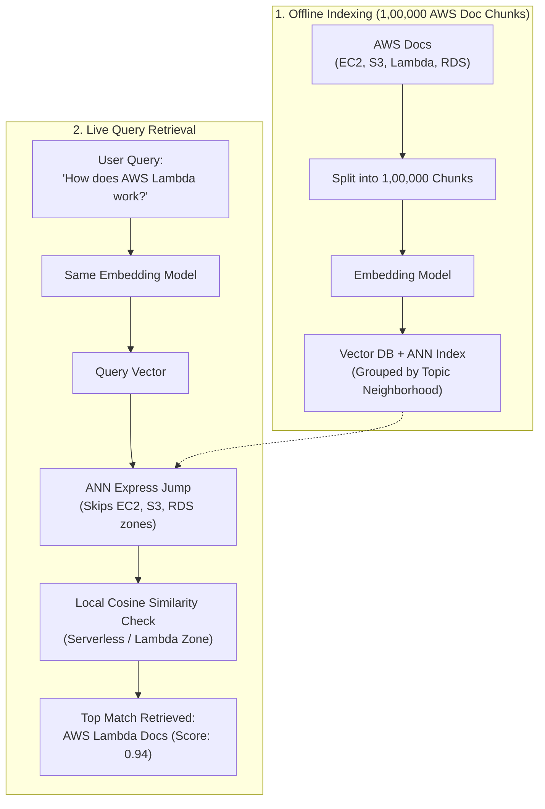

# AI Embeddings, Vectors, Cosine Similarity, Chunking & ANN — Complete Study Notes

---

## 1. What Are Embeddings in AI?

An **embedding** in AI is a dense numerical vector (a list of decimal numbers) that represents complex data—such as text, images, audio, or graph nodes—so machines can process meaning and relationships mathematically. Items with similar meanings or traits sit closer together in this vector space, while unrelated items sit farther apart.

### Core Properties
* **Dense Vectors:** Instead of massive, sparse lists (like one-hot encoding), embedding models output compact vectors (typically 384 to 3,072 dimensions).
* **Spatial Similarity:** Systems measure how closely two items relate using geometric distance or **Cosine Similarity** (the angle between vectors).
* **Learned During Training:** Neural networks learn these coordinates from large datasets by predicting context, matching pairs, or contrasting similar vs. dissimilar examples.

### Common Types of Embeddings
| Type | What It Represents | Examples |
| :--- | :--- | :--- |
| **Static Word Embeddings** | Assigns one fixed vector per word regardless of usage | Word2Vec, GloVe |
| **Contextual Embeddings** | Adjusts a token's vector based on surrounding words (e.g., *river bank* vs. *investment bank*) | BERT, GPT |
| **Sentence & Document Embeddings** | Represents full sentences, paragraphs, or passages | Sentence-BERT (SBERT), BGE, text-embedding-3 |
| **Image, Audio & Multimodal** | Maps visuals, sound, or aligned text-and-image pairs into a shared vector space | CLIP, Wav2Vec 2.0 |
| **Graph Embeddings** | Encodes network nodes and edges into vectors | Node2Vec, GraphSAGE |

### Where Embeddings Sit in the AI Hierarchy

---

## 2. The 3-Step Embedding Pipeline & Neural Network Math

AI models cannot directly read words, view pictures, or hear sounds—they only process numbers. An embedding model acts as a mathematical translator.

### Step-by-Step Neural Network Math
1. **Input Encoding:** Raw text is split into tokens and mapped to initial IDs; images become pixel grids (0–255); audio becomes frequency slices.
2. **Weighted Sums (Matrix Multiplication):** Incoming values travel through network layers, multiplying by learned weights ($W$) and adding biases ($B$):

$$Y = W \cdot X + B$$

3. **Activation Functions (Filtering):** Non-linear functions (**ReLU** or **GELU**) suppress irrelevant noise and pass meaningful signals forward.
4. **Output Projection:** The final layer compresses all signals into a fixed-length vector (e.g., `[0.82, -0.14, 0.91, ...]`).

---

## 3. Vector Math & Similarity Metrics

For two vectors $A = [a_1, a_2, \dots, a_n]$ and $B = [b_1, b_2, \dots, b_n]$:

### Basic Vector Operations
* **Vector Addition:** Combines components position by position:

$$A + B = [a_1 + b_1, \; a_2 + b_2, \; \dots, \; a_n + b_n]$$

* **Vector Subtraction:** Measures the difference or directional offset between concepts (e.g., $	ext{King} - 	ext{Man} + 	ext{Woman} pprox 	ext{Queen}$):

$$A - B = [a_1 - b_1, \; a_2 - b_2, \; \dots, \; a_n - b_n]$$

* **Dot Product ($A \cdot B$):** Multiplies matching positions and sums the products:

$$A \cdot B = (a_1 	imes b_1) + (a_2 	imes b_2) + \dots + (a_n 	imes b_n)$$

* **Magnitude / Length ($\lVert A 
Vert$):** Measures the geometric length of a vector from the origin $(0, 0, \dots, 0)$:

$$\lVert A 
Vert = \sqrt{a_1^2 + a_2^2 + \dots + a_n^2}$$

### Euclidean Distance vs. Cosine Similarity

| Feature | Euclidean Distance | Cosine Similarity |
| :--- | :--- | :--- |
| **What It Measures** | Straight-line distance between two points | Cosine of the angle ($	heta$) between two vectors |
| **Formula (2D)** | $d = \sqrt{(x_2 - x_1)^2 + (y_2 - y_1)^2}$ | $\cos(	heta) = rac{A \cdot B}{\lVert A 
Vert 	imes \lVert B 
Vert}$ |
| **Sensitivity to Length** | Sensitive to vector magnitude/size | Ignores vector length/size |
| **Exact Match Score** | $0$ | $1$ |
| **Best Use Cases** | Spatial data, coordinates, physical clustering | Text embeddings, RAG, semantic search |

> **Key Difference:** A short tweet and a long article on the exact same topic will have a **large Euclidean distance** (due to length difference) but a **high Cosine Similarity** (because both point in the same semantic direction).

---

## 4. Worked Numerical Examples

### Example 1: 2D Vectors — $A = [3, 4]$ and $B = [4, 3]$
* **Addition:** $[3 + 4, \; 4 + 3] = [7, 7]$
* **Subtraction:** $[3 - 4, \; 4 - 3] = [-1, 1]$
* **Dot Product ($A \cdot B$):** $(3 	imes 4) + (4 	imes 3) = 12 + 12 = 24$
* **Magnitudes:** $\lVert A 
Vert = \sqrt{3^2 + 4^2} = \sqrt{25} = 5$, $\lVert B 
Vert = \sqrt{4^2 + 3^2} = \sqrt{25} = 5$
* **Cosine Similarity:**

$$\cos(	heta) = rac{24}{5 	imes 5} = rac{24}{25} = \mathbf{0.96} \quad (	ext{96\% similar})$$

---

### Example 2: 2D Vectors — $A = [3, 5]$ and $B = [4, 6]$
* **Addition:** $[3 + 4, \; 5 + 6] = [7, 11]$
* **Subtraction:** $[3 - 4, \; 5 - 6] = [-1, -1]$
* **Dot Product ($A \cdot B$):** $(3 	imes 4) + (5 	imes 6) = 12 + 30 = 42$
* **Magnitudes:** $\lVert A 
Vert = \sqrt{3^2 + 5^2} = \sqrt{34} pprox 5.831$, $\lVert B 
Vert = \sqrt{4^2 + 6^2} = \sqrt{52} pprox 7.211$
* **Cosine Similarity:**

$$\cos(	heta) = rac{42}{\sqrt{34} 	imes \sqrt{52}} pprox rac{42}{42.05} pprox \mathbf{0.999} \quad (	ext{99.9\% similar})$$

---

### Example 3: 3D Vectors — $A = [2, 3, 4]$ and $B = [3, 4, 5]$
* **Addition:** $[2 + 3, \; 3 + 4, \; 4 + 5] = [5, 7, 9]$
* **Subtraction:** $[2 - 3, \; 3 - 4, \; 4 - 5] = [-1, -1, -1]$
* **Dot Product ($A \cdot B$):** $(2 	imes 3) + (3 	imes 4) + (4 	imes 5) = 6 + 12 + 20 = 38$
* **Magnitudes:** $\lVert A 
Vert = \sqrt{2^2 + 3^2 + 4^2} = \sqrt{29} pprox 5.3852$, $\lVert B 
Vert = \sqrt{3^2 + 4^2 + 5^2} = \sqrt{50} pprox 7.0711$
* **Cosine Similarity:**

$$\cos(	heta) = rac{38}{\sqrt{29} 	imes \sqrt{50}} pprox rac{38}{38.0789} pprox \mathbf{0.9979} \quad (	ext{99.79\% similar})$$

---

### Example 4: Scaled 3D Vectors — $A = [2, 3, 4]$ and $B = [5, 6, 7]$
* **Dot Product ($A \cdot B$):** $(2 	imes 5) + (3 	imes 6) + (4 	imes 7) = 10 + 18 + 28 = 56$
* **Magnitudes:** $\lVert A 
Vert = \sqrt{2^2 + 3^2 + 4^2} = \sqrt{29} pprox 5.3852$, $\lVert B 
Vert = \sqrt{5^2 + 6^2 + 7^2} = \sqrt{110} pprox 10.4881$
* **Cosine Similarity:**

$$\cos(	heta) = rac{56}{\sqrt{29} 	imes \sqrt{110}} pprox rac{56}{56.4801} pprox \mathbf{0.9926} \quad (	ext{99.26\% similar})$$

---

## 5. Chunking in AI Embeddings

**Chunking** is the process of breaking large documents (PDFs, manuals, books) into smaller, focused pieces of text before generating embeddings. Each chunk gets its own vector.

### Why Chunking Matters
1. **Model Token Limits:** Embedding models have strict context limits (e.g., 512 or 8,192 tokens).
2. **Sharper Retrieval Accuracy:** Combining a whole book into one vector blurs unrelated topics together. Small chunks keep each vector focused on one idea.
3. **Cost & Context Efficiency:** In RAG pipelines, only the top 2–3 relevant chunks are passed to the LLM.

### Chunking Strategies & Overlap
* **Fixed-Size Chunking:** Splits every $N$ tokens or characters (fast, but may split mid-sentence).
* **Recursive / Structure-Aware Chunking:** Splits along paragraphs, headings, and sentence boundaries first.
* **Semantic Chunking:** Uses embeddings to split whenever the topic shifts.
* **Chunk Overlap (10%–20%):** Repeats a small window of text across adjacent chunk boundaries so context is never lost at the cut line.

---

## 6. Fast Retrieval at Scale: Approximate Nearest Neighbor (ANN)

When searching across **1,00,000+ chunks** (for example, full AWS documentation covering EC2, S3, Lambda, and RDS), comparing a user query against every single vector one by one (**Brute-Force / Exact k-NN**) is too slow.

**ANN (Approximate Nearest Neighbor)** builds an index ahead of time to skip ~95% of irrelevant vectors, delivering **98%–99% accuracy at 100x speed**.

### Popular ANN Indexing Algorithms
| Algorithm | Analogy | How It Works |
| :--- | :--- | :--- |
| **HNSW** *(Hierarchical Navigable Small World)* | **Highway + Local Streets** | Builds multi-layer graphs; uses top-layer express links to jump across the vector space quickly, then zooms into bottom-layer local neighbors. |
| **IVF** *(Inverted File Index)* | **Library Shelving / Buckets** | Clusters vectors into labeled partitions (Voronoi cells) during indexing and only searches the closest buckets at query time. |
