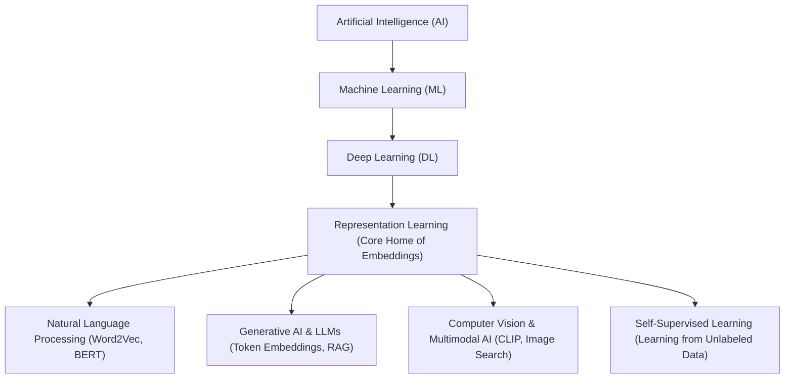
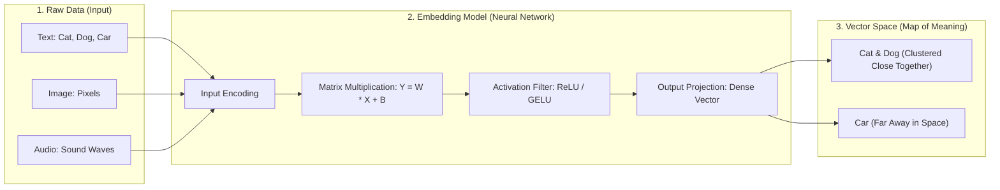
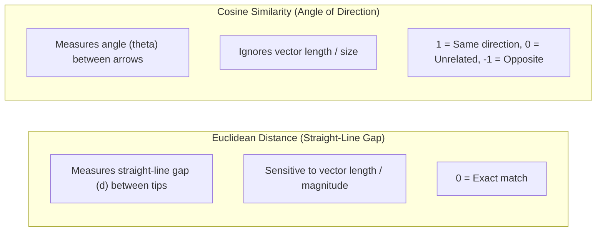
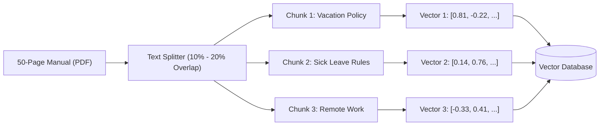
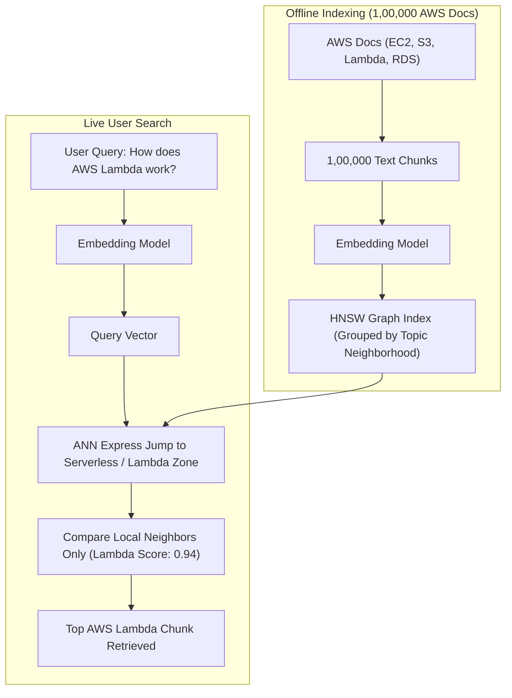

# AI Embeddings, Vector Math & Retrieval Notes

## 1. What Is an Embedding in AI?

An **embedding** in AI is a numerical vector (a list of decimal numbers) that represents complex, unstructured data—such as text, images, audio, or graph nodes—so machines can process meaning and relationships mathematically. Items with similar meanings or traits sit closer together in this vector space, while unrelated items sit farther apart.

### Where Embeddings Fit in AI
Embeddings fall primarily under **Representation Learning**, a core subfield of **Machine Learning (ML)** and **Deep Learning (DL)**, acting as a foundational bridge across multiple branches of AI:

### How Embeddings Work
* **Dense vectors:** Instead of huge, sparse lists (like one-hot encoding), embedding models output compact, dense vectors (commonly hundreds or thousands of dimensions).
* **Spatial similarity:** Systems measure how closely two items relate using geometric distance or **cosine similarity** (the angle between vectors).
* **Learned during training:** Neural networks learn these coordinates from large datasets by predicting context, matching pairs, or contrasting similar vs. dissimilar examples.

### Common Types of Embeddings
* **Static word embeddings:** Assign one fixed vector per word regardless of context (e.g., *Word2Vec*, *GloVe*).
* **Contextual embeddings:** Adjust a token's vector based on surrounding words (e.g., *BERT*, *GPT*), distinguishing *"river bank"* from *"investment bank"*.
* **Sentence, image, audio, and multimodal embeddings:** Represent full passages, visuals, sound, or aligned text-and-image spaces (e.g., *Sentence-BERT*, *CLIP*, *Wav2Vec 2.0*).
* **Graph embeddings:** Encode nodes and edges into vectors for network and relationship tasks (e.g., *Node2Vec*, *GraphSAGE*).

### Key AI Use Cases
* **Semantic search:** Finds relevant results by meaning even when exact keywords do not match.
* **Retrieval-Augmented Generation (RAG):** Converts user queries and knowledge chunks into vectors to retrieve relevant context for large language models.
* **Recommendations & clustering:** Groups similar products, articles, media, or anomalies.

---

## 2. The 3-Step Embedding Pipeline & Neural Network Math

### Step-by-Step Math Inside the Embedding Model
1. **Input Encoding:** Raw data is converted into initial numbers—tokens for text, pixel brightness/color values ($0$ to $255$) for images, or frequency slices for audio.
2. **Weighted Sums (Matrix Multiplication):** Each neural network layer multiplies incoming numbers ($X$) by learned weights ($W$) and adds a bias ($B$):

$$
Y = W \cdot X + B
$$

3. **Activation Functions:** Non-linear filters like **ReLU** or **GELU** suppress irrelevant signals toward zero and pass meaningful feature patterns forward.
4. **Output Projection:** The final layer compresses the processed signals into a fixed-length list of numbers, such as $[0.82, -0.14, 0.91, \dots]$.
5. **Vector Space Mapping:** Related items (like *Cat* and *Dog*) land close together, while unrelated items (like *Car*) sit far apart.

---

## 3. Vector Math & Similarity Metrics

### Core Vector Operations
Given two vectors $A = [a_1, a_2, \dots, a_n]$ and $B = [b_1, b_2, \dots, b_n]$:

* **Vector Addition:** Adds matching positions together:

$$
A + B = [a_1 + b_1,\; a_2 + b_2,\; \dots,\; a_n + b_n]
$$

* **Vector Subtraction:** Subtracts matching positions to capture direction/difference:

$$
A - B = [a_1 - b_1,\; a_2 - b_2,\; \dots,\; a_n - b_n]
$$

* **Dot Product ($A \cdot B$):** Multiplies matching positions and sums the results:

$$
A \cdot B = (a_1 \times b_1) + (a_2 \times b_2) + \dots + (a_n \times b_n)
$$

* **Vector Magnitude / Length ($\lVert A \rVert$):** Measures the straight-line length of a vector from the origin $(0,0)$:

$$
\lVert A \rVert = \sqrt{a_1^2 + a_2^2 + \dots + a_n^2}
$$

### Euclidean Distance vs. Cosine Similarity

| Feature | Euclidean Distance ($d$) | Cosine Similarity ($\cos(\theta)$) |
| :--- | :--- | :--- |
| **What It Measures** | Straight-line distance between vector endpoints | Angle between two vector arrows |
| **Formula (2D)** | $d = \sqrt{(x_2 - x_1)^2 + (y_2 - y_1)^2}$ | $\cos(\theta) = \frac{A \cdot B}{\lVert A \rVert \times \lVert B \rVert}$ |
| **Sensitivity to Length** | Sensitive to vector magnitude/size | Ignores vector length/size |
| **Exact Match Score** | $0$ | $1$ |
| **Best Use Cases** | Spatial data, coordinates, physical clustering | Text embeddings, RAG, semantic search |

> **Key Difference:** A short tweet and a long article on the exact same topic will have a **large Euclidean distance** (due to length difference) but a **high Cosine Similarity** (because both point in the same semantic direction).

---

## 4. Worked Numerical Examples

### Example 1: 2D Vectors — $A = [3, 4]$ and $B = [4, 3]$
* **Addition:** $[3 + 4,\; 4 + 3] = [7, 7]$
* **Subtraction:** $[3 - 4,\; 4 - 3] = [-1, 1]$
* **Dot Product ($A \cdot B$):** $(3 \times 4) + (4 \times 3) = 12 + 12 = 24$
* **Magnitudes:** $\lVert A \rVert = \sqrt{3^2 + 4^2} = \sqrt{25} = 5$, $\lVert B \rVert = \sqrt{4^2 + 3^2} = \sqrt{25} = 5$
* **Cosine Similarity:**

$$
\cos(\theta) = \frac{24}{5 \times 5} = \frac{24}{25} = \mathbf{0.96} \quad (\text{96\% similar})
$$

---

### Example 2: 2D Vectors — $A = [3, 5]$ and $B = [4, 6]$
* **Addition:** $[3 + 4,\; 5 + 6] = [7, 11]$
* **Subtraction:** $[3 - 4,\; 5 - 6] = [-1, -1]$
* **Dot Product ($A \cdot B$):** $(3 \times 4) + (5 \times 6) = 12 + 30 = 42$
* **Magnitudes:** $\lVert A \rVert = \sqrt{3^2 + 5^2} = \sqrt{34} \approx 5.831$, $\lVert B \rVert = \sqrt{4^2 + 6^2} = \sqrt{52} \approx 7.211$
* **Cosine Similarity:**

$$
\cos(\theta) = \frac{42}{\sqrt{34} \times \sqrt{52}} \approx \frac{42}{42.05} \approx \mathbf{0.999} \quad (\text{99.9\% similar})
$$

---

### Example 3: 3D Vectors — $A = [2, 3, 4]$ and $B = [3, 4, 5]$
* **Addition:** $[2 + 3,\; 3 + 4,\; 4 + 5] = [5, 7, 9]$
* **Subtraction:** $[2 - 3,\; 3 - 4,\; 4 - 5] = [-1, -1, -1]$
* **Dot Product ($A \cdot B$):** $(2 \times 3) + (3 \times 4) + (4 \times 5) = 6 + 12 + 20 = 38$
* **Magnitudes:**
  * $\lVert A \rVert = \sqrt{2^2 + 3^2 + 4^2} = \sqrt{4 + 9 + 16} = \sqrt{29} \approx 5.3852$
  * $\lVert B \rVert = \sqrt{3^2 + 4^2 + 5^2} = \sqrt{9 + 16 + 25} = \sqrt{50} \approx 7.0711$
* **Cosine Similarity:**

$$
\cos(\theta) = \frac{38}{\sqrt{29} \times \sqrt{50}} = \frac{38}{\sqrt{1450}} \approx \frac{38}{38.0789} \approx \mathbf{0.9979} \quad (\text{99.79\% similar})
$$

---

### Example 4: Scaled 3D Vectors — $A = [2, 3, 4]$ and $B = [5, 6, 7]$
* **Dot Product ($A \cdot B$):** $(2 \times 5) + (3 \times 6) + (4 \times 7) = 10 + 18 + 28 = 56$
* **Magnitudes:**
  * $\lVert A \rVert = \sqrt{2^2 + 3^2 + 4^2} = \sqrt{29} \approx 5.3852$
  * $\lVert B \rVert = \sqrt{5^2 + 6^2 + 7^2} = \sqrt{25 + 36 + 49} = \sqrt{110} \approx 10.4881$
* **Cosine Similarity:**

$$
\cos(\theta) = \frac{56}{\sqrt{29} \times \sqrt{110}} = \frac{56}{\sqrt{3190}} \approx \frac{56}{56.4801} \approx \mathbf{0.9926} \quad (\text{99.26\% similar})
$$

> **Takeaway:** Even though $B$ has much larger values than $A$, both point in nearly the same direction, yielding a **99.26%** similarity score.

---

## 5. Chunking in AI Embeddings

**Chunking** is the process of splitting large documents (PDFs, manuals, articles) into smaller, focused pieces of text before converting them into embedding vectors.

### Why Chunking Matters
* **Respects token limits:** Embedding models have fixed maximum input sizes (e.g., $512$ or $8,192$ tokens).
* **Prevents topic dilution:** Compressing an entire 50-page manual into one vector averages out distinct topics and weakens search accuracy.
* **Improves RAG precision:** Retrieval-Augmented Generation fetches only the top $2$–$3$ relevant chunks instead of feeding entire documents into an LLM.

### Common Chunking Strategies
* **Fixed-size chunking:** Splits text every $N$ characters or tokens (fast, though it may split mid-sentence).
* **Recursive / paragraph chunking:** Splits along natural boundaries—headings, paragraphs, and sentences—to keep complete thoughts intact.
* **Semantic chunking:** Detects topic shifts using embeddings and starts a new chunk whenever the subject changes.
* **Chunk overlap:** Repeats $10\%$–$20\%$ of text across adjacent chunks so context is not lost at boundary cuts.

---

## 6. Fast Retrieval at Scale: ANN (Approximate Nearest Neighbor)

When searching across **1,00,000+ chunks** (such as full AWS documentation for EC2, S3, Lambda, and RDS), comparing a user query one-by-one against every vector (brute-force k-NN) is too slow. Vector databases use **ANN (Approximate Nearest Neighbor)** indexing to retrieve top matches in milliseconds.

### How ANN Works
1. **Pre-builds a topic map:** During ingestion, vectors are grouped into neighborhoods by semantic similarity (e.g., S3 chunks in one region, Lambda chunks in another).
2. **Skips unrelated zones:** When you ask *"How does AWS Lambda work?"*, ANN jumps straight to the Serverless/Lambda neighborhood, ignoring $95\%+$ of unrelated chunks.
3. **Calculates local similarity:** It computes cosine similarity on only a small handful of nearby candidates, achieving **$98\%$–$99\%$ recall at $100\times$ the speed**.

### Two Popular ANN Indexing Algorithms
* **HNSW (Hierarchical Navigable Small World):** Uses multi-layer express highways to cross the vector map quickly, then local links to pinpoint the exact nearest neighbor.
* **IVF (Inverted File Index):** Partitions vectors into Voronoi clusters/buckets so search only scans the closest matching bucket(s).
