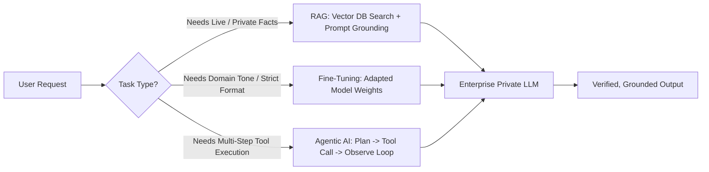
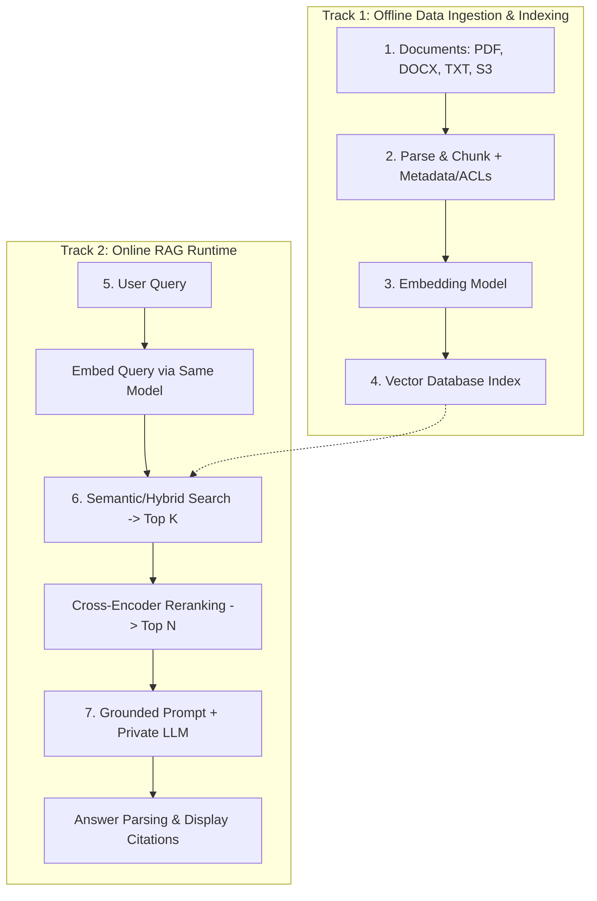
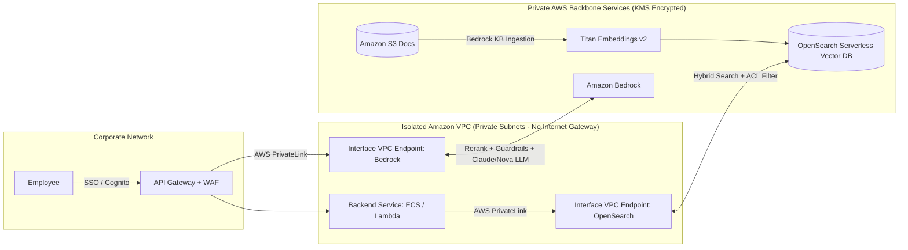

# Enterprise Gen AI, LLM, RAG & Agentic AI Architecture Notes

---

## 1. Core Foundations & Knowledge Boundaries

### Concept Hierarchy: AI -> Gen AI -> LLM -> GPT
```text
[ ARTIFICIAL INTELLIGENCE (AI) ]
   └── [ GENERATIVE AI ]
          └── [ LARGE LANGUAGE MODELS (LLMs) ]  <── Broad Category
                 ├── GPT Series (OpenAI: GPT-4o, o1/o3)  <── Specific Model Family
                 ├── Claude Series (Anthropic)
                 ├── Gemini Series (Google)
                 └── Llama Series (Meta - Open Weights)
```

* **Gen AI & LLM:** Generative AI creates new content, and Large Language Models (LLMs) are text reasoning engines trained to predict the next most likely token based on statistical patterns—not by querying a live database of facts.
* **GPT vs. LLM:** **LLM** is the industry-wide umbrella term for large language models; **GPT (Generative Pre-trained Transformer)** is OpenAI's specific family of decoder-only transformer models. Every GPT is an LLM, but not every LLM is a GPT.
* **Cutoff Date (Time Boundary):** The timestamp when an LLM's training dataset froze. Standalone models have zero knowledge of events, regulations, or software releases after this date.
* **Private Data (Access Boundary):** Internal company documents, customer records, emails, and SQL databases that reside behind corporate firewalls and were never part of public pre-training.
* **Hallucination (Failure Mode):** When prompted about post-cutoff events or private data without external context, an LLM fills the knowledge gap by guessing—generating confident, plausible-sounding falsehoods.

---

## 2. Diagnostic Chain: Roadblock -> Root Cause -> Solution

| Layer | Roadblock | Root Cause | Architectural Solution |
| :--- | :--- | :--- | :--- |
| **Knowledge & Trust** | Outdated answers, missing internal company context, and fabricated facts (**hallucinations**). | Static model weights frozen at a **cutoff date**, no access to **private data**, and probabilistic next-word prediction. | **Embeddings + Vector DB + RAG:** Convert private/live docs into vectors and inject verified snippets into the prompt at runtime. |
| **Behavior & Style** | General LLMs struggle with niche industry jargon, strict JSON/code schemas, or specific brand tone. | Pre-training optimizes for broad internet patterns rather than narrow enterprise formatting rules. | **Fine-Tuning:** Update model weights (e.g., via LoRA) on curated domain examples (often paired *with* RAG for facts). |
| **Execution & Workflow** | Standard RAG chatbots only answer single Q&A prompts—they cannot execute multi-step business tasks. | Basic RAG is a passive, single-turn pipeline with no planning loop or external API tool execution. | **Agentic AI:** Wrap the LLM in a continuous **Plan -> Act -> Observe** loop with memory, RAG tools, and enterprise APIs. |

---

## 3. Operational Playbook: RAG vs. Fine-Tuning vs. Agentic AI



* **What:**
  * **RAG:** Open-book runtime retrieval that feeds relevant private/recent chunks into the prompt.
  * **Fine-Tuning:** Skill and style training that adapts internal model weights on domain input/output pairs.
  * **Agentic AI:** Autonomous orchestration where an LLM plans steps, queries RAG/SQL/APIs, observes results, and iterates until a goal is completed.
* **Why:**
  * **RAG** eliminates hallucinations and bypasses cutoff dates without expensive model retraining.
  * **Fine-Tuning** enforces strict output schemas (JSON/SQL) and domain vocabulary.
  * **Agentic AI** automates end-to-end workflows across multiple enterprise systems.
* **When:**
  * Use **RAG** for changing policies, wikis, PDFs, and workflows requiring source citations.
  * Use **Fine-Tuning** when prompt engineering alone cannot enforce formatting, tone, or domain terminology.
  * Use **Agentic AI** when a request requires multi-step reasoning, database lookups, and external API actions.

---

## 4. Chunking, Embeddings, Vectors & Vector Databases

### How Semantic Search Works
```text
[ RAW TEXT ]                [ EMBEDDING MODEL ]          [ VECTOR (Coordinates) ]        [ VECTOR DATABASE ]
"Reset my VPN password" ──► Neural Network Encoder ──► [0.12, -0.84, 0.56, ...] ──► Indexed with HNSW for fast
                                                                                     semantic similarity search
```

1. **Chunking (With Overlap):** Large manuals (e.g., 50-page PDFs) are split along natural paragraph/section boundaries into focused passages (300–500 tokens) with a **10%–15% overlap** so sentences at split lines never lose context.
2. **Embedding Model:** Translates text, images, or audio into dense numerical arrays (typically 768 to 3,072 floating-point numbers) encoding semantic *meaning* rather than exact keywords.
3. **Vector & Vector Space:** Each numerical array acts as coordinates in multi-dimensional space. Concepts with similar intent (*"Reset VPN password"* and *"Fix remote login"*) cluster closely together.
4. **Vector Database & HNSW Index:** Specialized databases (Amazon OpenSearch Serverless, PostgreSQL `pgvector`, Pinecone, Qdrant) use **HNSW (Hierarchical Navigable Small World)** graph indexes to run **Approximate Nearest Neighbor (ANN)** search—finding the top match across 100,000+ chunks in milliseconds.

---

## 5. Worked Vector Mathematics (Cosine Similarity)

Cosine Similarity measures the angle between two vectors—capturing **direction (meaning)** while ignoring **length (magnitude)**:

$$\text{Cosine Similarity} = \cos(\theta) = \frac{A \cdot B}{\|A\| \times \|B\|}$$

* **`1.0`** = Identical direction (exact semantic match)
* **`0.0`** = Orthogonal (completely unrelated)
* **`-1.0`** = Opposite direction

### Example 1: 2D Vector Pair — $A = [3, 4]$ vs. $B = [4, 3]$
1. **Dot Product ($A \cdot B$):** $(3 \times 4) + (4 \times 3) = 12 + 12 = \mathbf{24}$
2. **Magnitudes:** $\|A\| = \sqrt{3^2 + 4^2} = \sqrt{25} = \mathbf{5}$, $\|B\| = \sqrt{4^2 + 3^2} = \sqrt{25} = \mathbf{5}$
3. **Multiply Magnitudes:** $5 \times 5 = \mathbf{25}$
4. **Final Score:** $\frac{24}{25} = \mathbf{0.96}$ (**96.0% Similar**)

### Example 2: 3D Vector Pair — $A = [2, 3, 4]$ vs. $B = [5, 6, 7]$
1. **Dot Product ($A \cdot B$):** $(2 \times 5) + (3 \times 6) + (4 \times 7) = 10 + 18 + 28 = \mathbf{56}$
2. **Magnitude of A ($\|A\|$):** $\sqrt{2^2 + 3^2 + 4^2} = \sqrt{4 + 9 + 16} = \sqrt{29} \approx \mathbf{5.3852}$
3. **Magnitude of B ($\|B\|$):** $\sqrt{5^2 + 6^2 + 7^2} = \sqrt{25 + 36 + 49} = \sqrt{110} \approx \mathbf{10.4881}$
4. **Multiply Magnitudes:** $5.3852 \times 10.4881 \approx \mathbf{56.4801}$
5. **Final Score:** $\frac{56}{56.4801} \approx \mathbf{0.9926}$ (**99.26% Similar**)
   * *Key Insight:* Even though Arrow $B$ is nearly twice as long as Arrow $A$, both point in nearly the same direction—proving why a short user query accurately matches a long document chunk.

### Example 3: RAG Query Ranking (HR Leave Policy)
* **Chunk 1 (`C1` — Leave Policy):** *"Employees get 20 days of paid annual leave."* $\rightarrow \vec{C_1} = [0.90, 0.05, 0.10]$
* **Chunk 2 (`C2` — Cafeteria):** *"The office cafeteria serves lunch at 1 PM."* $\rightarrow \vec{C_2} = [0.05, 0.95, 0.20]$
* **User Query (`Q`):** *"How many vacation days do I get?"* $\rightarrow \vec{Q} = [0.85, 0.00, 0.15]$
* **Scores:**
  * $\text{Similarity}(\vec{Q}, \vec{C_1}) = \frac{0.780}{0.863 \times 0.907} \approx \mathbf{0.996}$ (**99.6% Match — Selected #1**)
  * $\text{Similarity}(\vec{Q}, \vec{C_2}) = \frac{0.0725}{0.863 \times 0.972} \approx \mathbf{0.086}$ (**8.6% Match — Discarded**)

---

## 6. Why an LLM Is Still Required With RAG

* **RAG (The Retriever / Librarian):** Searches the vector index and fetches raw, messy document excerpts. It cannot reason, compare conditions, or write conversational answers.
* **LLM (The Analyst / Reasoning Brain):** Reads the retrieved chunks, applies logic (e.g., comparing an employee's tenure against policy rules), filters out irrelevant sentences, synthesizes multiple chunks, and generates a cited natural-language response.

---

## 7. End-to-End 7-Step RAG Pipeline & Production Tracks



### Track 3: Compute & Deployment Maturity Progression
1. **Experimentation:** Google Colab / Jupyter Notebooks (prototyping chunk sizes and prompts).
2. **Virtual Machines:** Amazon EC2 (full OS control for custom APIs or local open-weights models).
3. **Serverless & Containers:** Docker Containers, AWS Lambda, Amazon ECS, Amazon EKS (scalable microservices).
4. **Managed Enterprise AI Platforms:** Amazon Bedrock Knowledge Bases / Microsoft Foundry (managed ingestion, vector sync, reranking, guardrails, and VPC isolation).

---

## 8. Enterprise Data Privacy & AWS Private Architecture

### Public Base Weights vs. Private Runtime Execution
* **Base LLM Weights (Publicly Pre-Trained):** Models like Claude, Llama, and Titan are pre-trained on public datasets to learn language and reasoning.
* **Enterprise Runtime (100% Private):** Inside an enterprise VPC (via AWS Bedrock, Azure OpenAI, or self-hosted vLLM/SageMaker), inference runs in a stateless, isolated environment with **Zero Data Retention**—your prompts, retrieved documents, and answers never traverse the public internet and never train public models.

### AWS Private Enterprise RAG Blueprint


---

## 9. Runnable Python RAG API (FastAPI + LangChain)

```python
from fastapi import FastAPI
from pydantic import BaseModel
from langchain_core.documents import Document
from langchain_core.prompts import ChatPromptTemplate
from langchain_core.runnables import RunnablePassthrough
from langchain_core.output_parsers import StrOutputParser
from langchain_text_splitters import RecursiveCharacterTextSplitter
from langchain_community.vectorstores import FAISS
from langchain_aws import BedrockEmbeddings, ChatBedrockConverse

app = FastAPI(title="Enterprise RAG API")

# 1. Sample Private Documents (Replace with PyPDFLoader / S3Loader in production)
raw_docs = [
    Document(
        page_content="Employees receive 20 days of paid annual leave after 6 months of continuous service.",
        metadata={"source": "HR_Policy_2026.pdf", "section": "4.2"},
    ),
    Document(
        page_content="The office cafeteria serves lunch daily from 12:30 PM to 2:00 PM.",
        metadata={"source": "Facilities_Guide.pdf", "section": "1.1"},
    ),
]

# 2. Parse & Chunk with Overlap
splitter = RecursiveCharacterTextSplitter(chunk_size=300, chunk_overlap=50)
chunks = splitter.split_documents(raw_docs)

# 3. Embed & Store in Vector Index
embeddings = BedrockEmbeddings(model_id="amazon.titan-embed-text-v2:0", region_name="us-east-1")
vector_store = FAISS.from_documents(chunks, embeddings)
retriever = vector_store.as_retriever(search_kwargs={"k": 2})

def format_docs(docs: list[Document]) -> str:
    return "\n\n".join(
        f"[Source: {d.metadata.get('source')} | Sec {d.metadata.get('section')}] {d.page_content}"
        for d in docs
    )

# 4. Grounded Prompt + Zero-Temperature Private LLM
prompt = ChatPromptTemplate.from_template(
    """Answer the user's question using ONLY the provided context.
If the answer is not in the context, reply: "I don't have enough information in the company documents."
Always cite the source document.

Context:
{context}

Question: {question}
"""
)

llm = ChatBedrockConverse(
    model="anthropic.claude-3-5-sonnet-20241022-v2:0",
    region_name="us-east-1",
    temperature=0.0,
)

rag_chain = (
    {"context": retriever | format_docs, "question": RunnablePassthrough()}
    | prompt
    | llm
    | StrOutputParser()
)

class QueryRequest(BaseModel):
    question: str

@app.post("/ask")
def ask_rag(request: QueryRequest):
    return {"answer": rag_chain.invoke(request.question)}
```
