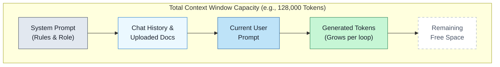
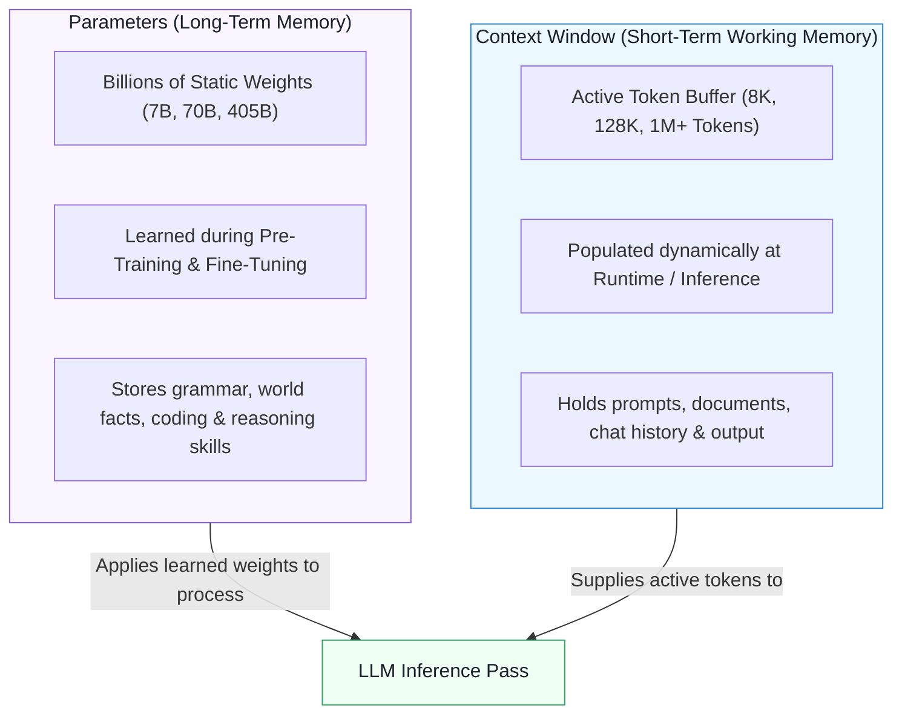

# Generative AI & LLM Fundamentals — Study Notes

Comprehensive reference notes covering the Large Language Model (LLM) inference pipeline, context windows, model parameters, decoding temperature, and prompt engineering—formatted for GitHub Markdown with Mermaid diagrams.

---

## Table of Contents
1. [LLM Inference Pipeline](#1-llm-inference-pipeline)
2. [Context Window](#2-context-window)
3. [Parameters vs. Context Window](#3-parameters-vs-context-window)
4. [Temperature & Decoding Strategy](#4-temperature--decoding-strategy)
5. [Prompting & Prompt Engineering](#5-prompting--prompt-engineering)

---

## 1. LLM Inference Pipeline

The end-to-end LLM inference process converts raw human text into numerical token IDs, passes them through neural network layers to calculate next-token probabilities, selects a token using a decoding strategy, and loops autoregressively until producing readable text.

### End-to-End Inference Diagram

```mermaid
flowchart LR
    A["1. User Prompt<br/>(Raw String)"] --> B["2. Tokenization<br/>(Subword Splitting)"]
    B --> C["3. Token IDs<br/>(Vocab Indices)"]
    C --> D["4. Model Layers<br/>(Embeddings + Attention + FFN)"]
    D --> E["5. Next-Token Scores<br/>(Logits -> Softmax)"]
    E --> F["6. Decoding Strategy<br/>(Greedy / Temp / Top-p)"]
    F --> G["7. Generated Token<br/>(Single Token ID)"]
    G -->|"Autoregressive Loop<br/>(Repeat until EOS)"| D
    G -->|"Sequence Complete"| H["8. Readable Text<br/>(Detokenization)"]

    style A fill:#ebf8ff,stroke:#3182ce,color:#1a202c
    style B fill:#ebf8ff,stroke:#3182ce,color:#1a202c
    style C fill:#ebf8ff,stroke:#3182ce,color:#1a202c
    style D fill:#faf5ff,stroke:#805ad5,color:#1a202c
    style E fill:#faf5ff,stroke:#805ad5,color:#1a202c
    style F fill:#fffaf0,stroke:#dd6b20,color:#1a202c
    style G fill:#f0fff4,stroke:#38a169,color:#1a202c
    style H fill:#f0fff4,stroke:#38a169,color:#1a202c
```

### Step-by-Step Breakdown

1. **User Prompt:** The raw text input typed by the user (e.g., `"What is AI?"`), often wrapped behind the scenes with hidden system instructions and chat role tags.
2. **Tokenization:** A tokenizer algorithm (such as Byte-Pair Encoding / BPE or WordPiece) splits raw text into chunks called **tokens** (whole words, subwords, punctuation, or leading spaces). On average, $1	ext{ token} pprox rac{3}{4}$ of an English word.
3. **Token IDs:** Each token is mapped to a unique integer index in the model's fixed vocabulary table (typically $32{,}000$ to $128{,}000+$ entries), e.g., `["What", " is", " AI", "?"]` $
ightarrow$ `[2061, 374, 15592, 30]`.
4. **Model Layers (Transformer Forward Pass):**
   - **Embeddings + Positional Encoding:** Converts token IDs into high-dimensional vectors capturing semantic meaning and word order.
   - **Self-Attention:** Enables every token to weigh its relationship with preceding tokens to resolve context.
   - **Feed-Forward Networks (FFN):** Transforms and refines extracted feature patterns across stacked Transformer blocks.
5. **Next-Token Scores (Logits & Softmax):** The final layer outputs a raw numerical score (**logit**) for every token in the vocabulary. The **Softmax** function normalizes these logits into probabilities summing to $1.0$ ($100\%$).
6. **Decoding Strategy:** Selects the next token ID from the probability distribution using rules such as **Greedy Decoding**, **Temperature**, **Top-$k$**, or **Top-$p$ (Nucleus) Sampling**.
7. **Generated Tokens (Autoregressive Loop):** LLMs generate **one token at a time**. The newly chosen token ID is appended to the input sequence and fed back into Step 4 to predict the subsequent token until an **End-of-Sequence (`<EOS>`)** token is emitted or the maximum token limit is reached.
8. **Readable Text (Detokenization):** The generated sequence of token IDs is mapped back through the vocabulary in reverse to reconstruct human-readable strings.

---

## 2. Context Window

A **context window** is the maximum number of tokens an LLM can hold and attend to in its active working memory during a single inference pass. It acts as a shared capacity limit covering **both** the input sequence and the generated output.

### Context Window Memory Allocation

### Key Mechanics & Implications

- **Dynamic Consumption:** Every newly generated token in the autoregressive loop consumes $1$ token slot from the remaining capacity.
- **Overflow / Truncation:** Once $	ext{Input Tokens} + 	ext{Output Tokens}$ hits the window ceiling, older tokens at the beginning of the conversation are dropped (truncated) or summarized, causing the model to lose early context.
- **Compute & KV Cache Cost:** Self-attention compares tokens across the window; longer active contexts require significantly more GPU memory (VRAM) for the **Key-Value (KV) Cache** and increase latency.
- **Lost in the Middle:** Models consistently retrieve details located at the **very beginning** or **very end** of a long context window more reliably than facts buried in the middle.

---

## 3. Parameters vs. Context Window

In Generative AI, **parameters** and the **context window** represent two distinct forms of memory that scale independently: **long-term static knowledge** versus **short-term working capacity**.

### Architectural Relationship

### Side-by-Side Comparison

| Dimension | Parameters (Model Weights) | Context Window (Token Capacity) |
| :--- | :--- | :--- |
| **Analogy** | The model's **brainpower & education** | The model's **desk space & scratchpad** |
| **Definition** | Numerical weights and biases inside model layers | Max combined input + output tokens held at once |
| **Typical Scale** | Millions to Hundreds of Billions (`7B`, `70B`, `405B`) | Thousands to Millions (`8K`, `128K`, `1M+` tokens) |
| **When It Changes** | Frozen after training (unless fine-tuned) | Resets and changes with every prompt/session |
| **Primary Impact** | **Intelligence:** Reasoning depth, nuance, accuracy | **Capacity:** Volume of data/history read simultaneously |

### Practical Design Combinations

- **Small Parameters + Large Context (e.g., `8B` model, `128K` window):** Fast and inexpensive; ideal for summarizing or extracting facts from large documents, though weaker at deep multi-step reasoning.
- **Large Parameters + Small Context (e.g., `70B` model, `8K` window):** Strong at complex logic, math, and architecture design, but quickly hits limits on large files or long multi-turn chats.

---

## 4. Temperature & Decoding Strategy

**Temperature ($T$)** is a runtime decoding hyperparameter that controls the randomness and predictability of token selection without altering the model's underlying weights.

### Mathematical Formulation

Before applying the **Softmax** function at Step 5/6 of the pipeline, each raw logit $z_i$ is divided by the temperature $T$:

$$P(w_i) = rac{\exp(z_i / T)}{\sum_{j} \exp(z_j / T)}$$

- **Lower $T$ ($0 < T < 1$):** Magnifies differences between logits, **sharpening** the probability distribution so top-ranked tokens dominate.
- **Higher $T$ ($T > 1$):** Compresses differences between logits, **flattening** the probability distribution so lower-probability tokens have a higher chance of being sampled.

### Temperature Ranges & Use Cases

| Temperature | Effect on Distribution | Output Behavior | Recommended Use Cases |
| :--- | :--- | :--- | :--- |
| **$T = 0$** | Equivalent to **Greedy Decoding** (top token = $100\%$) | Deterministic, repeatable, strictly picks highest-probability token | JSON/data extraction, SQL, math, classification |
| **$T = 0.1 - 0.4$** | Sharpens peak probabilities | Focused, factual, consistent phrasing with minimal variance | Technical Q&A, summarization, code generation |
| **$T = 0.5 - 0.8$** | Preserves natural learned distribution | Balanced coherence, natural tone, moderate lexical variety | General chat, emails, documentation drafting |
| **$T = 0.9 - 1.5+$** | Flattens distribution toward uniform | Highly creative and diverse; higher risk of incoherence or hallucination | Creative writing, brainstorming, marketing copy |

> **Interaction Note:** Temperature works alongside **Top-$p$ (Nucleus Sampling)** and **Top-$k$ Sampling**. If `top_p` is set very low (e.g., `0.1`), raising `temperature` will have minimal effect because unlikely tokens are already truncated from the candidate pool before sampling occurs.

---

## 5. Prompting & Prompt Engineering

**Prompting (Prompt Engineering)** is the discipline of structuring input text inside the context window to steer an LLM's next-token probability distribution toward accurate, reliable, and well-formatted responses—without modifying model parameters.

### Prompt Construction Workflow

### Anatomy of a Production Prompt

1. **Role / Persona:** Establishes domain expertise, tone, and perspective (e.g., *"You are a senior cloud security engineer..."*).
2. **Task / Instruction:** Uses explicit action verbs (*Extract*, *Compare*, *Refactor*, *Classify*).
3. **Context & Grounding Data:** Supplies reference facts or source documents to ground answers and prevent hallucination.
4. **Constraints & Guardrails:** Sets explicit boundaries on length, scope, and fallback behavior (e.g., *"If the answer is not present in the context, reply 'Not found'."*).
5. **Output Format:** Specifies exact structure (JSON schema, Markdown table, bullet list).

### Core Prompting Techniques

| Technique | Mechanism | Best Use Cases | Example Pattern |
| :--- | :--- | :--- | :--- |
| **Zero-Shot** | Direct instruction with zero examples provided | Simple classification, translation, straightforward Q&A | *"Classify sentiment as Positive or Negative: 'Great battery life.'"* |
| **Few-Shot** | Includes $2	ext{--}5$ input/output examples to establish a pattern | Strict formatting, domain-specific labeling, style matching | *"Text: 'Fast delivery' -> POS
Text: 'Arrived broken' -> NEG
Text: 'Decent quality' ->"* |
| **Chain-of-Thought (CoT)** | Prompts step-by-step reasoning before emitting the final answer | Math, logic puzzles, multi-step debugging, complex analysis | *"Solve step-by-step, showing all intermediate work, then state the final answer."* |
| **System / Role Prompting** | Sets persistent global rules at the start of the context window | Custom assistants, tutoring bots, policy enforcement | *"You are a Socratic tutor. Guide students with hints rather than giving direct answers."* |
| **Delimiter Framing** | Isolates untrusted user data or documents using XML tags or quotes | Document summarization, mitigating **prompt injection** | *"Summarize only the content enclosed within `<document></document>` tags."* |

### Why Chain-of-Thought Improves Accuracy

Because LLMs generate **one token per forward pass**, forcing an immediate final answer on a hard problem restricts computation to a single pass. Instructing the model to *"think step-by-step"* turns each intermediate reasoning step into visible tokens inside the **context window**, providing an external working scratchpad that conditions subsequent attention passes.

### Best Practices Checklist

- **Use Affirmative Instructions:** Specify what the model **should do** rather than relying solely on negative prohibitions (e.g., prefer *"Use simple everyday vocabulary"* over *"Don't use jargon"*).
- **Anchor Key Rules at the Edges:** Mitigate *Lost in the Middle* by placing primary instructions in the **System Prompt** and repeating critical output constraints at the **very end** of long prompts.
- **Align Prompting with Decoding Hyperparameters:** Pair deterministic prompts (JSON extraction, code, CoT math) with **low temperature ($T \le 0.2$)**, and open-ended ideation prompts with **higher temperature ($T pprox 0.7	ext{--}0.9$)**.
