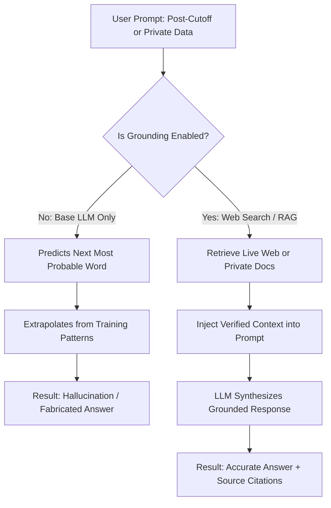

# GenAI & LLMs: Knowledge Cutoffs, Private Data, and Hallucinations

In Generative AI, **knowledge cutoff dates** and the **lack of access to private data** are two primary triggers for Large Language Model (LLM) hallucinations. Because LLMs generate text by predicting the most probable next token rather than querying a verified database, asking them about facts outside their training scope forces them to guess—often resulting in confident, plausible-sounding falsehoods.

---

## Architecture & Workflow Diagram

GitHub natively renders [Mermaid](https://mermaid.js.org/) diagrams inside Markdown files. Below is how a standard LLM handles out-of-scope queries versus a grounded RAG/Search pipeline:

---

## 1. Knowledge Cutoff Dates

* **What it is:** A knowledge cutoff is the specific date when an LLM’s training dataset was frozen. The model has zero built-in awareness of events, laws, software updates, or facts that occurred after that timestamp.
* **Why it causes hallucinations:** If you ask an offline model about post-cutoff news without enabling real-time tools, it will extrapolate from older patterns and invent details to satisfy your prompt.
* **How to fix it:** Connect the model to live web search or browsing tools (such as web-enabled chat interfaces, search APIs, or grounding tools) so it fetches current facts before generating an answer.

---

## 2. Private Data Gaps

* **What it is:** Public LLMs are trained only on publicly available internet data, licensed datasets, and open repositories. They have no access to internal company wikis, proprietary code, customer records, or personal documents.
* **Why it causes hallucinations:** When prompted about internal policies, private metrics, or enterprise workflows, a base LLM cannot look up the truth and will fabricate answers based on generic industry assumptions.
* **How to fix it:** Instead of retraining a model from scratch, connect it securely to internal files using **Retrieval-Augmented Generation (RAG)**.

---

## 3. Core Solutions to Prevent Hallucinations

| Technique | How It Works | Primary Benefit |
| :--- | :--- | :--- |
| **Retrieval-Augmented Generation (RAG)** | A search system retrieves relevant snippets from private documents or live databases and feeds them into the prompt alongside the user's question. | Grounds answers strictly in verified, up-to-date context. |
| **Strict System Prompting** | Instructs the model to reply with *"I don't know"* when the provided context does not contain the answer. | Prevents the model from speculating or guessing. |
| **Temperature Control** | Lowers the model's `temperature` parameter close to `0` to reduce token randomness. | Keeps responses factual, consistent, and deterministic. |
| **Source Citations** | Requires the model to quote or link directly to the exact internal document or web source used for each claim. | Makes outputs auditable and easy to verify. |

---

## Quick Reference Checklist for Implementation

- [ ] Enable **Web Grounding** for queries requiring post-cutoff or real-time information.
- [ ] Build a **RAG pipeline** (chunking, embeddings, vector search) for private or proprietary knowledge bases.
- [ ] Set `temperature = 0.0` (or near zero) for factual Q&A tasks.
- [ ] Add explicit fallback instructions in the system prompt (e.g., *"Answer only using the provided context. If unsure, state that you do not have enough information."*).
- [ ] Enforce inline citations pointing back to source documents.
