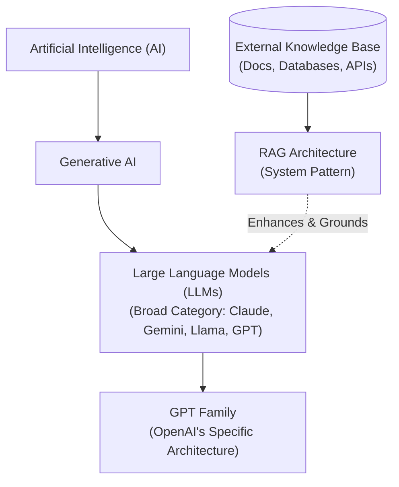
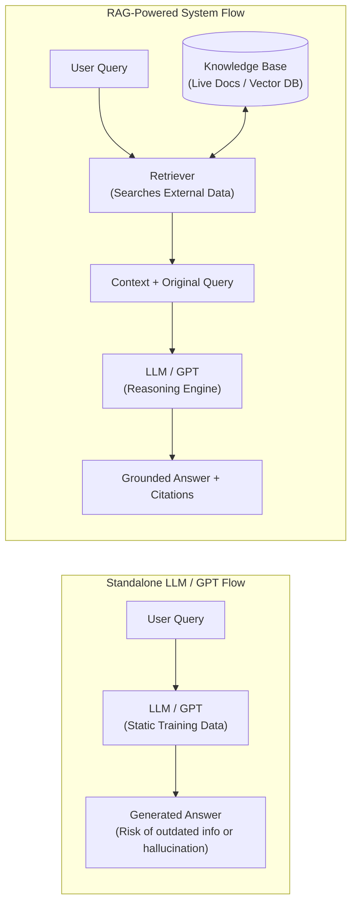

# LLM vs. GPT vs. RAG: Complete Study Notes

## Quick Summary
* **LLM (Large Language Model):** The broad category of AI models trained on massive datasets to understand and generate human-like text.
* **GPT (Generative Pre-trained Transformer):** A specific family of LLMs developed by OpenAI. *Every GPT is an LLM, but not every LLM is a GPT.*
* **RAG (Retrieval-Augmented Generation):** An architectural pattern—not a standalone model—that connects an LLM to external, up-to-date data sources before generating an answer.

---

## Visual Architecture & Relationship Diagrams

### 1. Hierarchy: LLM vs. GPT vs. RAG

### 2. Standalone LLM/GPT vs. RAG Workflow

---

## Core Definitions

### 1. LLM (Large Language Model)
* **What it is:** A large neural network trained on vast amounts of text and code to predict the next token in a sequence.
* **Examples:** GPT models (OpenAI), Claude (Anthropic), Gemini (Google), Llama (Meta), DeepSeek.
* **Role:** Acts as the foundational language understanding, reasoning, and text generation engine.

### 2. GPT (Generative Pre-trained Transformer)
* **What it is:** OpenAI's specific decoder-only transformer model architecture and product line.
* **Everyday Usage Note:** In casual conversation, "GPT" often refers to OpenAI's ChatGPT interface or custom user-configured GPT assistants.
* **Relationship to LLM:** GPT is a subset of LLMs.

### 3. RAG (Retrieval-Augmented Generation)
* **What it is:** A system design pattern that fetches relevant facts from an external knowledge base at query time and injects them into the LLM's prompt.
* **Components:**
  1. **Knowledge Store:** Documents, databases, wikis, or APIs (often indexed as embeddings in a vector database).
  2. **Retriever:** Finds the most relevant snippets matching the user's question.
  3. **Generator (LLM/GPT):** Synthesizes the retrieved snippets into a coherent response.

---

## Key Differences Comparison

| Dimension | Standalone LLM / GPT | RAG (LLM + Retrieval Pipeline) |
| :--- | :--- | :--- |
| **Nature** | Core AI model / model family | System architecture / design pattern |
| **Knowledge Source** | Static pre-training data (up to a cutoff date) | Dynamic external data fetched at query time |
| **Updating Knowledge** | Requires expensive retraining or fine-tuning | Simply add, edit, or delete files in the database |
| **Accuracy & Hallucinations** | May guess on niche, private, or recent topics | Grounded in retrieved facts; lower hallucination rate |
| **Traceability** | Hard to verify exact source of a claim | Can cite exact source documents or links |
| **Scalability for Docs** | Limited by model context window / file limits | Scales across large enterprise document collections |

---

## When to Use Which

### Use a Standalone LLM / GPT When:
* Brainstorming ideas or drafting creative content
* Summarizing or rewriting text you directly paste into the prompt
* Writing general-purpose code or debugging standard syntax
* Solving logic, math, or general knowledge problems that do not require private or live data

### Use RAG (LLM + External Retrieval) When:
* Building internal company Q&A bots over private wikis, PDFs, or policies
* Powering customer support assistants over live product documentation
* Working in compliance, legal, or medical domains where citations are mandatory
* Answering questions about rapidly changing data (e.g., inventory, news, live records)
